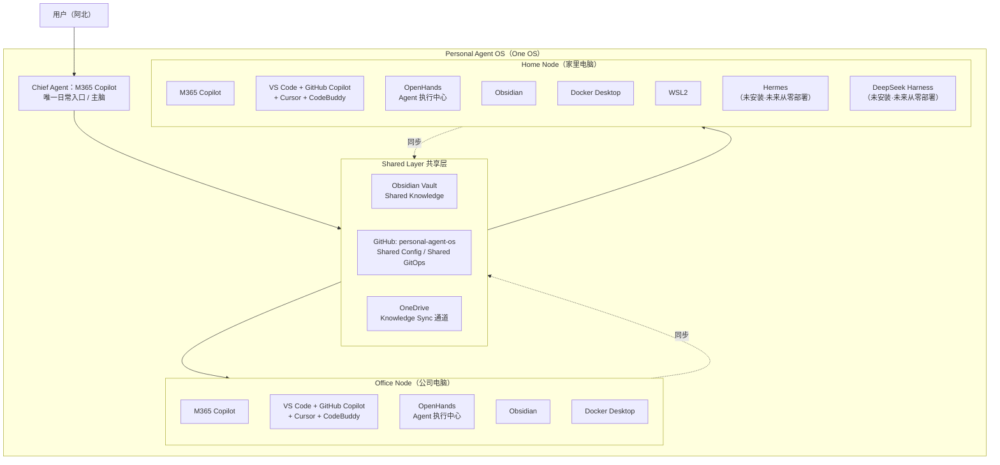
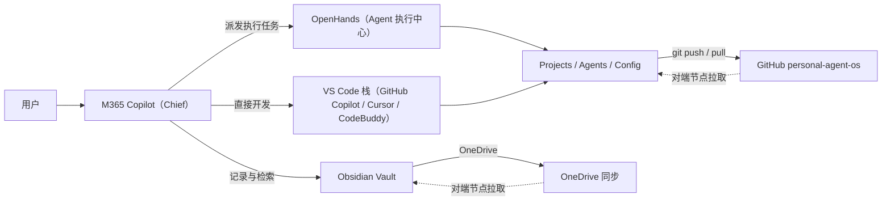
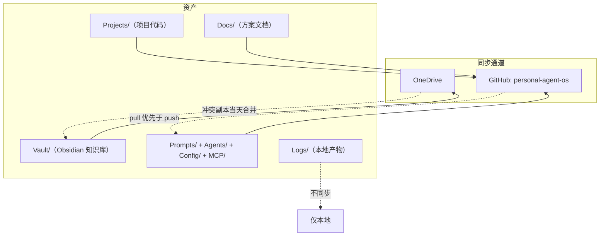
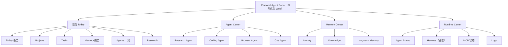
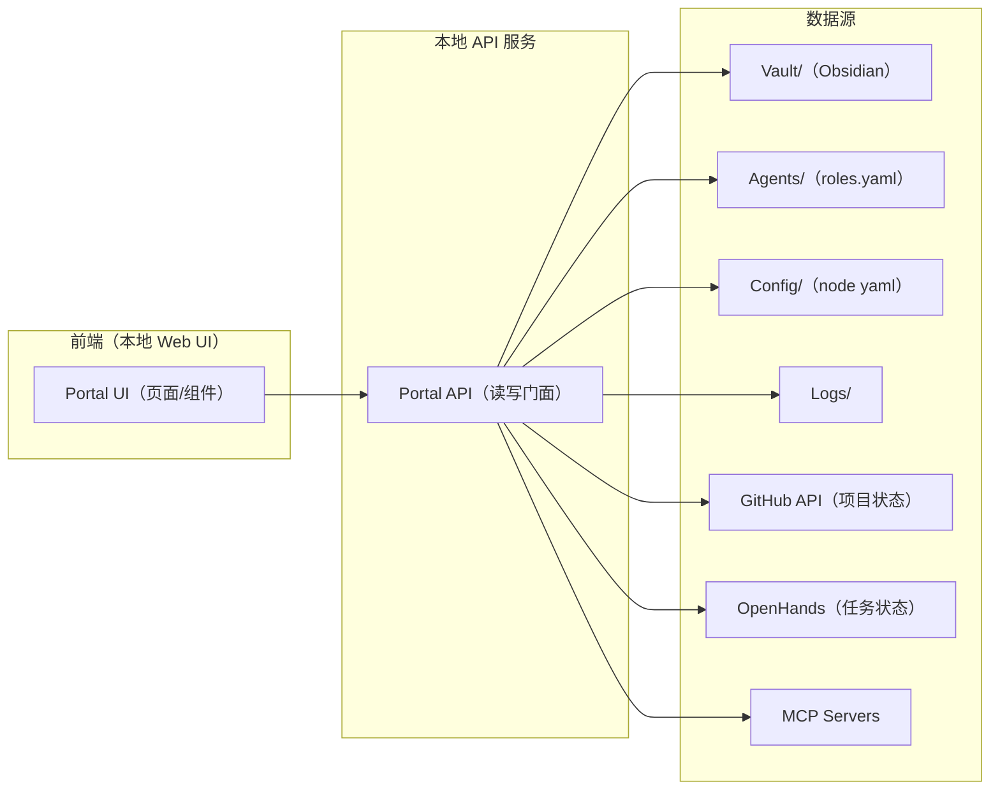
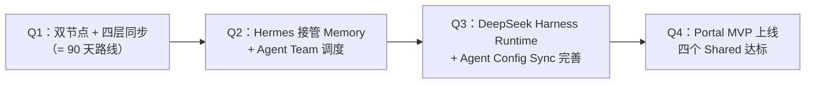
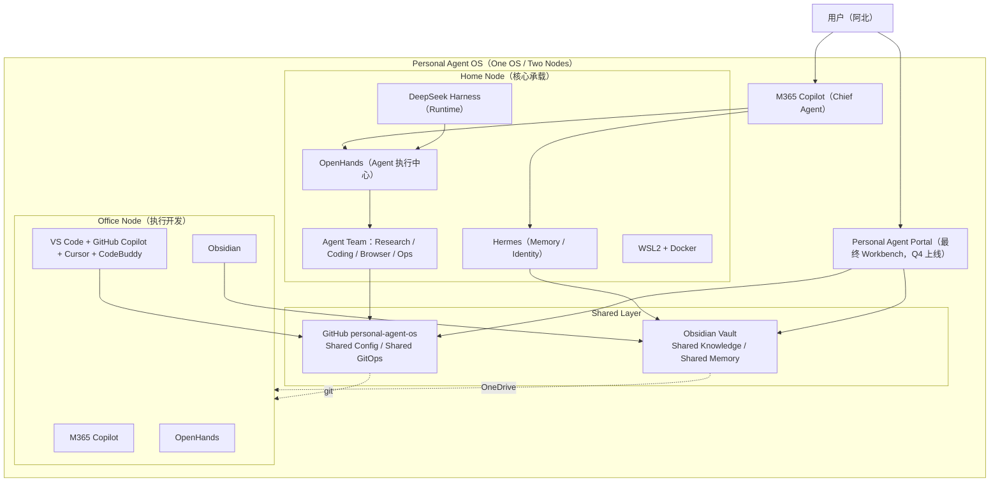

# Dual-Node Personal Agent OS V1 实施方案

> 版本：V1.0
> 日期：2026-10-17
> 定位：架构级设计与可落地方案
> 约定：本文只讨论架构、职责、节点、同步、落地，不讨论任何工具的 Star 数、排名或热度。

## 文档信息

| 项 | 内容 |
| --- | --- |
| 系统名称 | Personal Agent OS（个人智能体操作系统） |
| 形态 | One Personal Agent OS / Two Nodes |
| 节点 | Office Node（公司电脑）+ Home Node（家里电脑） |
| 共享目标 | Shared Knowledge / Shared Config / Shared GitOps / Shared Memory |
| 根目录标准 | `D:\Personal-Agent-OS`（两台电脑逐字一致） |
| 当前状态 | V1：Hermes 与 DeepSeek Harness **在两台电脑上均未安装**，全文按"未来从零部署"设计，不假设任何现存能力 |

## 目录

- 第一部分 Dual Node Architecture（双节点总体架构）
- 第二部分 节点职责与安装顺序
- 第三部分 同步体系设计
- 第四部分 OpenHands 定位论证（重点）
- 第五部分 Personal Agent Portal MVP
- 第六部分 第一周落地检查表
- 第七部分 90 天三阶段落地路线图
- 第八部分 未来 12 个月实施路线（最重要）
- 第九部分 Personal Agent OS V1 MVP：只留 6 个组件
- 附录 A 目录标准与文件规范
- 附录 B 组件栈总表

---

## 第一部分 Dual Node Architecture（双节点总体架构）

### 1.1 设计原则

1. **One OS, Two Nodes**：公司电脑与家里电脑不是两套 Agent 系统，而是同一个 Personal Agent OS 的两个节点。任何一台电脑上的知识、配置、Agent 定义、项目，在另一台上必须可见、可用、一致。
2. **单一入口原则**：日常入口只允许一个——Chief Agent（M365 Copilot）。禁止同时向 Copilot、Cursor、CodeBuddy、OpenHands 多头提问，否则必然出现"谁负责什么、知识放哪里、哪个 Agent 是真正入口"的混乱。
3. **分层原则**：系统按 Chief / Thinking / Memory / Runtime / Agent / Coding / Infra 七层组织，每层只放"实际能长期使用"的组件。
4. **同步优先原则**：知识、配置、Prompt、Agent 定义全部走同步层；任何节点本地独有的状态都必须显式声明并记入 `Config/`。
5. **从零部署原则**：Hermes 与 DeepSeek Harness 在两台电脑上都未安装。本文所有相关设计按"未来从零部署"描述，不虚构其能力。
6. **现实约束优先**：架构围绕"能长期使用的工具"设计，而不是围绕"最强工具"设计。

### 1.2 总体架构图



### 1.3 组件分层总表

| 层 | 组件 | 当前状态 | 职责 |
| --- | --- | --- | --- |
| Chief Agent | M365 Copilot | 已可用 | 唯一日常入口、主脑、任务派发 |
| Thinking Layer | M365 Copilot、Google AI Studio | 已可用 | 思考、规划、研究、Prompt 实验 |
| Memory Layer | Obsidian | 已可用 | 当前唯一记忆源（Knowledge + Memory 单源） |
| Memory Layer（未来） | Hermes Agent | 未安装 | 未来接管 Memory / Identity / User Profile / Skill |
| Runtime Layer（未来） | DeepSeek Harness | 未安装 | 未来 Agent Runtime，V1 仅做接口预留 |
| Agent / Execution Layer | OpenHands | 待安装 | Agent 执行中心（详见第四部分论证） |
| Coding Layer | VS Code + GitHub Copilot + Cursor + CodeBuddy | 已可用 / 待安装 | 统一入口为 VS Code，其余为执行层工具 |
| Infrastructure | GitHub、Docker Desktop、WSL2（仅 Home Node）、OneDrive | 部分可用 | 同步与运行底座 |

### 1.4 数据流图



---

## 第二部分 节点职责与安装顺序

### 2.1 Office Node（公司电脑）

**运行组件**：M365 Copilot、VS Code、GitHub Copilot、Cursor、CodeBuddy、OpenHands、Obsidian、Docker Desktop。

**职责**：办公、研究、开发、任务执行。它是"外出执行节点"——人在公司时的主要工作面，所有任务型工作在这里发起和完成。

**安装顺序**：

| 档位 | 组件 | 理由 |
| --- | --- | --- |
| 必装 | VS Code | 统一编码入口，所有 Coding 层工具挂在它上面 |
| 必装 | Git | GitOps Sync 的本地前提，无 Git 即无配置同步 |
| 必装 | GitHub Copilot | 编码层基础补全与辅助，成本最低、收益最直接 |
| 必装 | CodeBuddy | 代码 Agent，承担日常编码执行 |
| 必装 | Obsidian | Knowledge / Memory 的本地视图，接入 OneDrive 同步 |
| 必装 | OpenHands | Agent 执行中心，承接 Chief 派发的任务型工作 |
| 推荐 | Docker Desktop | 为 OpenHands 沙箱执行与未来 Runtime 做准备；公司策略允许再装 |
| 未来阶段 | Hermes | Memory / Identity 接管，从零部署（见第七、八部分） |
| 未来阶段 | DeepSeek Harness | Agent Runtime，从零部署（见第七、八部分） |

> 备注：M365 Copilot 属企业办公环境既有组件，不列入安装清单。Cursor 如需在 Office Node 使用，归入"推荐"档与 Docker 并列（可选），不强制。

### 2.2 Home Node（家里电脑）

**运行组件**：M365 Copilot、VS Code、GitHub Copilot、Cursor、CodeBuddy、OpenHands、Obsidian、Docker Desktop、WSL2，以及未来的 Hermes、DeepSeek Harness。

**职责**：Agent Runtime、Memory、实验室、Portal 开发、长期 Agent。它是"核心承载节点"——重实验、长时任务、Runtime 与 Portal 开发放这里。

**安装顺序**：

| 档位 | 组件 | 理由 |
| --- | --- | --- |
| 必装 | VS Code | 统一编码入口 |
| 必装 | Git | GitOps Sync 本地前提 |
| 必装 | Obsidian | Knowledge / Memory 本地视图，OneDrive 同步 |
| 必装 | OpenHands | Agent 执行中心 |
| 必装 | Docker Desktop | Home Node 是实验与 Runtime 主场，沙箱执行是硬需求；安装时一并启用 WSL2 |
| 推荐 | Cursor | AI IDE，作为 VS Code 之外的第二种编码界面（按需启用） |
| 推荐 | CodeBuddy | 代码 Agent，与 Office Node 保持一致的工作习惯 |
| 未来阶段 | Hermes | 优先在 Home Node 从零部署，接管 Memory / Identity |
| 未来阶段 | DeepSeek Harness | 优先在 Home Node 从零部署，作为 Agent Runtime |

> 备注：WSL2 是 Home Node 专属组件，随 Docker Desktop 安装一并启用，Office Node 不装。

### 2.3 两节点差异对照表

| 维度 | Office Node | Home Node |
| --- | --- | --- |
| V1 组件数 | 8 | 8 + WSL2 |
| WSL2 | 否 | 是（随 Docker Desktop 启用） |
| Docker Desktop | 推荐 | 必装 |
| Cursor | 推荐（可选） | 推荐 |
| Hermes | 未来阶段 | 未来阶段（优先部署） |
| DeepSeek Harness | 未来阶段 | 未来阶段（优先部署） |
| 职责 | 办公 / 研究 / 开发 / 任务执行 | Agent Runtime / Memory / 实验室 / Portal 开发 / 长期 Agent |
| 日常入口 | M365 Copilot | M365 Copilot |
| 目录根 | `D:\Personal-Agent-OS` | `D:\Personal-Agent-OS`（逐字一致） |

> 原则：两节点组件差集 = Hermes + DeepSeek Harness + WSL2（且 Hermes/Harness 当前均未安装）。除 WSL2 外，两节点软件形态必须保持一致，避免形成两套 Agent OS。

---

## 第三部分 同步体系设计

同步体系是双节点架构的承重墙，分四层：Knowledge Sync、GitOps Sync、Memory Sync、Agent Config Sync。

### 3.1 Knowledge Sync（知识同步）

- **载体**：Obsidian Vault（`D:\Personal-Agent-OS\Vault`）+ OneDrive。
- **机制**：Vault 纳入 OneDrive 同步范围，两端本地各有一份完整副本，OneDrive 负责传输与冲突文件保留。
- **边界**：Vault 只放知识与笔记；不放代码、不放配置文件。
- **规则**：
  1. 同一文件避免两端同时编辑；OneDrive 产生冲突副本时，当天合并回主文件并删除副本。
  2. 附件统一放 `Vault/attachments/`，避免散落。
  3. Vault 同时纳入 Git 版本控制（见 3.2），双保险防误删。

### 3.2 GitOps Sync（配置与资产同步）

- **载体**：GitHub 仓库 `personal-agent-os`。
- **同步内容**：`Prompts/`（Prompt 资产）、`Config/`（节点配置）、`MCP/`（MCP 配置）、`Portal/`（Portal 源码，未来）、`Docs/`（方案文档）、`Agents/`（Agent 定义）、`Projects/`（项目代码）。
- **纪律**：
  1. 每天开工先 `git pull`，收工 `git push`；禁止长时间不拉取直接推送。
  2. 提交信息注明节点，如 `[office] update roles.yaml` / `[home] add portal spec`。
  3. `Logs/` 与本地敏感配置进 `.gitignore`，永不入库。
- **V1 现状**：仓库创建与首次推送属于 90 天路线第 1 阶段动作，由用户手动执行，本文只做设计定义。

### 3.3 Memory Sync（记忆同步）

- **V1 现状（Obsidian 单源）**：Memory = Obsidian Vault 中的约定目录（Identity / Knowledge / Long-term），两端经 OneDrive 天然同步；暂不引入第二记忆源，避免双写不一致。
- **未来（Hermes 部署后的双层机制，研究项）**：Hermes 接管 Memory / Identity / User Profile / Skill 后，需要研究并定义：
  1. Hermes 记忆存储与 Obsidian Vault 的映射关系（哪些记忆类型放哪层）；
  2. 导出/导入协议（Hermes → Markdown → Vault 的单向或双向流）；
  3. 冲突裁决规则（以哪一层为权威源）。
- **原则**：Hermes 未部署前，Memory Sync = Knowledge Sync，不提前虚构机制。

### 3.4 Agent Config Sync（Agent 配置同步）

- **载体**：`Agents/roles.yaml` + `Agents/agent-schema.md`，随 GitHub 仓库同步。
- **统一内容**：Agent Schema、Prompt、Role、Policy。
- **机制**：任何一端新增/修改 Agent 定义，必须提交仓库；另一端 pull 后生效。本地未提交的 Agent 改动视为不存在。
- **V1 Agent 清单**（详见 `Agents/roles.yaml`）：Chief / Research / Coding / Browser / Ops 五个角色，当前仅 Chief（M365 Copilot）在岗，其余为定义预留。

### 3.5 同步矩阵



**冲突处理总规则**：

| 冲突类型 | 处理方式 |
| --- | --- |
| OneDrive 冲突副本 | 当天人工合并回主文件，删除副本 |
| Git push 被拒 | 先 `git pull --rebase` 再推，禁止 force push |
| Agent 定义双端不一致 | 以 GitHub 仓库最新提交为权威，本地未提交视为无效 |
| Vault 与仓库内容放错位置 | 按 3.1/3.2 边界移回，Vault 不放配置，仓库不放私密日志 |

---

## 第四部分 OpenHands 定位论证（重点）

### 4.1 问题定义

OpenHands 到底是：

- **选项 A：最终 Workbench**——它是整个 Personal Agent OS 的最终工作台，用户的一切工作都在它里面发生；
- **选项 B：Agent Execution Center**——它只是 Agent 层的一个执行中心，负责任务的执行，不占据入口。

本文倾向（与用户一致）：**OpenHands = Agent Execution Center**。以下为重点论证。

### 4.2 OpenHands 是什么

OpenHands 是一个任务级的 AI 执行平台：给它一个任务（写代码、跑实验、改配置、批量处理文件），它在自己的沙箱/工作区里自主规划、执行、验证，最后交付结果。它的核心能力是"接任务 → 自主执行 → 交付"，而不是"陪聊 / 记事 / 管理知识"。

把它和手上的工具对照，边界非常清楚：

| 工具 | 本质 | 是否 Agent |
| --- | --- | --- |
| M365 Copilot | 对话式主脑 / 入口 | Chief Agent |
| Cursor / GitHub Copilot | 编码辅助 | Coding Assistant |
| CodeBuddy | 代码 Agent | Coding Assistant 偏执行 |
| OpenHands | 任务级自主执行平台 | **Agent** |
| Obsidian | 知识库 | 不是 Agent |
| Hermes（未来） | 记忆 / 身份系统 | Memory Agent |

即：Cursor / GitHub Copilot / CodeBuddy 这类是 Coding Assistant，OpenHands 才是 Agent。这个区分是论证的起点。

### 4.3 选项 A：OpenHands = 最终 Workbench

支持理由（先立后破）：

1. OpenHands 有完整的工作区概念，看起来"像"一个工作台；
2. 让它当最终 Workbench，入口集中，似乎符合"单一入口"。

致命问题：

1. **与 Chief 冲突**。本架构已确定 Chief Agent = M365 Copilot 且是唯一日常入口。若 OpenHands 同时是最终 Workbench，系统就有两个入口——用户遇到问题时先问 Copilot 还是先开 OpenHands？这正是对话中明确警告的失败模式：多入口抢权 → "谁负责什么、知识放哪里、哪个 Agent 是真正入口"全面混乱。
2. **定位错层**。Workbench 是"人工作的地方"，Agent 是"机器干活的地方"。把执行平台升格为最终工作台，等于让人去适应机器的边界。
3. **锁死演进**。一旦 OpenHands 成为最终 Workbench，未来 Hermes 接管 Memory、DeepSeek Harness 接管 Runtime、Portal 上线时，全部要绕开它或推翻它，架构失去演进空间。

### 4.4 选项 B：OpenHands = Agent Execution Center

论证三条：

1. **单一入口原则成立**。入口保持唯一（M365 Copilot），Chief 负责想清楚"做什么"，OpenHands 负责"把它做完"。人只面对一个界面，机器干活的界面可以有很多个——这符合"一个主脑 + 一队执行者"的组织形态。
2. **分层职责清晰**。OpenHands 承担 Coding / Task / Execution 三类工作，属于 Agent 层；它向上接受 Chief 派发，向下操作文件、代码、沙箱。它不需要知道"我是谁、记忆了什么"——那是 Memory 层（Obsidian → 未来 Hermes）的事。
3. **可扩展性**。执行中心是一个"被调度的角色"而不是"最终界面"：V1 由 Chief（人经由 Copilot）派发；Hermes 部署后可由 Hermes 调度；DeepSeek Harness 上线后可作为其执行后端之一。每一步演进都是"接入"，不是"推翻"。

### 4.5 裁决

**OpenHands = Agent Execution Center（选项 B）。**

推论：**"最终 Workbench"这个位置不废除，但不属于 V1 的任何一个已装组件——它由未来的 Personal Agent Portal 承担**（详见第五部分）。V1 的形态因此是：

```
M365 Copilot（入口/主脑）
      │ 派发
OpenHands（执行中心）── 操作 ──→ Projects / Agents / Config / Vault
```

OpenHands 只被"调用"，不被"围绕"。这是 V1 不混乱的关键。

---

## 第五部分 Personal Agent Portal MVP

### 5.1 定位

Personal Agent Portal 是未来自研的**最终 Workbench**：一个本地优先的 Web 控制台，把散落在 Copilot、OpenHands、Obsidian、GitHub 里的状态收敛到一个界面。V1 阶段它**不存在、不开发**，只做两件事：预留 `Portal/` 目录、写死 MVP 规格（本文 + `Portal/portal-mvp.md`），确保 90 天路线第 3 阶段启动开发时不返工。

### 5.2 信息架构（四大中心 + 首页）

**首页（Today）**

| 模块 | 内容 |
| --- | --- |
| Today | 今日任务、Chief 待办、Agent 执行队列 |
| Projects | 项目列表与状态（读 `Projects/` + GitHub） |
| Tasks | 任务流转（待派发 / 执行中 / 待验收） |
| Memory | 最近记忆、Identity 摘要（读 Vault） |
| Agents | Agent Team 状态一览 |
| Research | 研究线索与资料索引 |

**Agent Center（Agent 团队）**

| Agent | 职责 |
| --- | --- |
| Research Agent | 检索、调研、资料汇总（未来可由 Hermes 驱动） |
| Coding Agent | 编码执行（对接 CodeBuddy / Cursor / VS Code 栈） |
| Browser Agent | 浏览器任务（依赖 Browser MCP，见 `MCP/mcp-plan.md`） |
| Ops Agent | 同步巡检、配置治理、日志巡检 |

**Memory Center（记忆中心）**

| 模块 | 内容 |
| --- | --- |
| Identity | 我是谁、原则、边界（Vault/Identity） |
| Knowledge | 知识库索引与统计（Vault） |
| Long-term Memory | 长期记忆（V1 = Vault 约定目录；Hermes 部署后迁移，见 3.3） |

**Runtime Center（运行时中心）**

| 模块 | 内容 |
| --- | --- |
| Agent Status | 各 Agent 在线/忙碌/空闲 |
| Harness | DeepSeek Harness 状态（未安装，占位） |
| MCP | MCP Server 连接状态 |
| Logs | 执行日志（读 `Logs/`） |

### 5.3 页面结构图



### 5.4 组件图



### 5.5 技术选型建议（MVP）

- **形态**：本地优先，单机可跑；后端一个轻量 API 服务（如 Python FastAPI），前端静态页 + 少量交互，不引重框架。
- **数据**：不建新数据库，直接读 `D:\Personal-Agent-OS` 下的目录与文件（Vault / Agents / Config / Logs），GitHub 状态走 API。
- **部署**：Home Node 先行（`Portal/` 源码随 GitHub 同步，Office Node 可随时拉起）。
- **红线**：Portal 只做"收敛展示 + 轻操作"，不替代 Chief 的判断，不直连 Memory 写入——写入仍走 Obsidian 与 Agent Config Sync 的既有通道。

---

## 第六部分 第一周落地检查表

目标：一周内让"一个 OS、两个节点、四层同步"从纸面变成可验证的现实。原则：**一次性安装完成、分阶段启用**——安装可以快，启用必须一个一个来。

### Day 1：双节点地基

- [ ] 在两台电脑创建统一根目录 `D:\Personal-Agent-OS`，按附录 A 建齐全部目录（11 个 + Docs）
- [ ] 两台电脑安装 Git，完成 GitHub 账号（beipeonbei）登录与 SSH key 配置
- [ ] 创建本地 Obsidian Vault：`D:\Personal-Agent-OS\Vault`，建立 Identity / Knowledge / Long-term 三个约定目录
- [ ] Vault 纳入 OneDrive 同步，确认两台电脑都能看到同一份 Vault
- [ ] 验收标准：两台电脑目录树 `tree /f` 输出逐字一致；Vault 在一端新建笔记，另一端 5 分钟内可见

### Day 2：编码环境 + 仓库

- [ ] 两台电脑安装 VS Code + GitHub Copilot
- [ ] Office Node 安装 CodeBuddy；Home Node 安装 CodeBuddy 与 Cursor（按推荐档）
- [ ] 创建 GitHub 仓库 `personal-agent-os`（私有），纳入 `Prompts/ Agents/ Config/ MCP/ Docs/ Projects/ Portal/`
- [ ] 按 `.gitignore` 规则排除 `Logs/`，完成首次提交与推送
- [ ] 在另一台电脑 clone，验证 Config / Agents / Docs 拉取一致
- [ ] 验收标准：一端改 `Config/office-node.yaml` 提交，另一端 pull 后可见；Vault 冲突副本数为 0

### Day 3：执行中心 + Agent 定义

- [ ] 两台电脑安装 Docker Desktop（Home Node 必装并启用 WSL2；Office Node 按公司策略）
- [ ] 两台电脑安装 OpenHands，完成首次任务演练（如：批量重命名 `Projects/` 下文件并输出报告）
- [ ] 初始化 `Agents/roles.yaml` 与 `Agents/agent-schema.md`（Chief / Research / Coding / Browser / Ops 五角色）
- [ ] 初始化 `Prompts/system-prompts.md`（Chief 初始提示词 + 派发模板）
- [ ] 验收标准：OpenHands 能读写 `Projects/` 并在 `Logs/` 留下执行记录；roles.yaml 提交后两端一致

### Day 7：同步体系全链路验收 + MCP 首批接入

- [ ] 全链路演练：Office Node 改 Vault 笔记 + 提交仓库改动 → Home Node pull + OneDrive 同步 → 两端状态一致
- [ ] 按 `MCP/mcp-plan.md` 接入第一批 MCP Server（GitHub + 文件系统，最低限度两个）
- [ ] 填写 `Config/office-node.yaml` 与 `Config/home-node.yaml` 的真实值（node 标识、同步归属、已装组件清单）
- [ ] 复盘：记录第一周踩坑（OneDrive 冲突、Git  rebase、OpenHands 权限），写入 `Vault/Knowledge/`
- [ ] 验收标准：四层同步（Knowledge / GitOps / Memory / Agent Config）各跑通一次并留痕；检查表全部打勾

### 第一周末状态定义（V1 达标线）

- 两台电脑：统一目录、统一仓库、统一 Vault、统一 Agent 定义 ✅
- 入口唯一：M365 Copilot 是唯一日常入口 ✅
- 执行就绪：OpenHands 可接任务 ✅
- 未启用项如实记录：Hermes、DeepSeek Harness、Portal 均未安装，留在未来阶段 ✅

---

## 第七部分 90 天三阶段落地路线图

### 阶段 1（Day 1–30）：双节点同时搭建 + 四层同步

- 完成第六部分第一周检查表全部项目
- Office / Home 两节点必装档全部安装到位，推荐档按需启用
- 四层同步全链路稳定运行一周无冲突事故
- GitHub 仓库形成提交纪律（每日 pull/push，提交信息带节点前缀）
- **阶段验收**：任一端发起"改知识 → 改配置 → 派发 OpenHands 任务 → 对端可见"闭环演示成功

### 阶段 2（Day 31–60）：Hermes 从零部署 + 接入 Memory

- Home Node 从零安装 Hermes（当前未安装，无任何既有配置可依赖）
- 定义 Hermes 与 Obsidian 的边界：Hermes 接管 Memory / Identity / User Profile / Skill，Vault 仍是 Knowledge 权威源
- 落地 Memory Sync 双层机制（3.3 的研究项在此阶段变成实现项）：Hermes 记忆定期导出为 Markdown 落 Vault
- Chief 与 Hermes 的协作规则成文：谁答"是什么/为什么"，谁答"做什么/怎么做"
- **阶段验收**：Hermes 在 Home Node 连续运行 7 天；记忆导出 → Vault → OneDrive → Office Node 可见链路通

### 阶段 3（Day 61–90）：DeepSeek Harness 从零部署 + Runtime 接入 + Portal 启动

- Home Node 从零安装 DeepSeek Harness，按 `Harness/README.md` 的接口预留接入 OpenHands 与 Agent Team
- Agent Team 五角色（`Agents/roles.yaml`）在 Runtime 下试调度：Research / Coding / Browser / Ops 各跑一次真实任务
- Portal MVP 开发启动：按 `Portal/portal-mvp.md` 规格实现首页 + Agent Center + Memory Center 只读版
- **阶段验收**：一次端到端演示——Copilot 下任务 → Chief 派发 → OpenHands/Harness 执行 → 结果回写 Vault 与仓库 → Portal 可见

---

## 第八部分 未来 12 个月实施路线（最重要）

四个季度，每季一个主题，全部只讨论架构、职责、节点、同步、落地。



| 季度 | 主题 | 关键动作 | 达标标志 |
| --- | --- | --- | --- |
| Q1 | 双节点 + 四层同步 | 完成 90 天路线；两节点物理与配置一致 | One OS / Two Nodes 成立；四层同步零事故运行一个月 |
| Q2 | Hermes 接管 Memory | Home Node 部署 Hermes；Memory Sync 双层落地；Agent Team 试调度 | Memory 有权威分层；五角色至少三角色在岗 |
| Q3 | DeepSeek Harness Runtime | Home Node 部署 Harness；Agent Config Sync 规范化（Schema/Policy 强制校验） | 任务可被 Runtime 调度执行；Agent 定义变更有闸门 |
| Q4 | Portal MVP 上线 | Portal 四大中心只读版 + 轻操作；Runtime Center 接入 Harness/MCP/Logs | Shared Knowledge / Shared Config / Shared GitOps / Shared Memory 四项全部达标 |

### 完整实施架构图（12 个月目标态）



---

## 第九部分 Personal Agent OS V1 MVP：只留 6 个组件

### 9.1 问题

如果只允许保留 6 个组件，V1 保留哪些？为什么？

### 9.2 保留清单

| # | 组件 | 角色 | 保留理由 |
| --- | --- | --- | --- |
| 1 | M365 Copilot | Chief Agent | 唯一日常入口。每天都能用，比"更强但用不上"重要一万倍；没有它整个系统没有大脑 |
| 2 | Obsidian | Knowledge + Memory | 知识的唯一权威源。四层同步里 Knowledge Sync 和 V1 Memory Sync 全靠它；删掉它双节点只剩空壳 |
| 3 | VS Code + GitHub Copilot（计 1 个编码组件） | Coding | 编码执行的最小完整集：一个入口 + 一个辅助。Cursor / CodeBuddy 是增强，不是必需 |
| 4 | OpenHands | Agent 执行中心 | 系统里唯一的"任务级自主执行"能力，Chief 派发的活儿由它干；没有它，Chief 只能动口不能动手 |
| 5 | GitHub | GitOps + Config 同步 | Shared Config / Shared GitOps 的承重墙；Agent 定义、Prompt、文档、项目全走它；删掉它两节点必然分叉成两套系统 |
| 6 | OneDrive | Knowledge 同步通道 | Vault 跨节点的传输层；删掉它 Obsidian 只剩本地副本，Shared Knowledge 不成立 |

### 9.3 为什么是这 6 个（取舍逻辑）

1. **覆盖"想 → 记 → 做 → 同步"全链路**：Copilot 想、Obsidian 记、OpenHands 做、VS Code 编码、GitHub + OneDrive 同步。缺任何一个环节，链条断裂。
2. **入口与执行分离**：Copilot（入口）与 OpenHands（执行）必须同时保留——只有一个会退化成聊天玩具，另一个会退化成无人调度的工具箱。
3. **同步双轨缺一不可**：GitHub 管"配置与代码"（需要版本历史、需要评审），OneDrive 管"知识"（需要低摩擦、人在外面也要能改）。用 Git 同步 Vault 摩擦太大，用 OneDrive 同步代码没有版本纪律。
4. **编码只留一套**：VS Code + GitHub Copilot 已覆盖日常 80% 编码场景，Cursor / CodeBuddy 作为推荐档在完整架构里保留，但 MVP 容不下第二个编码界面。

### 9.4 落选组件去向

| 组件 | MVP 去向 | 完整架构中的位置 |
| --- | --- | --- |
| Cursor | 落选（推荐档） | Coding 层第二种界面，按需启用 |
| CodeBuddy | 落选（推荐档） | Coding 层代码 Agent，与 Copilot 分工 |
| Google AI Studio | 落选 | Thinking 层备用（Prompt 实验） |
| Docker Desktop | 落选（Home 必装） | OpenHands 沙箱与未来 Runtime 底座 |
| WSL2 | 落选（Home 专属） | Docker 与 Harness 的 Linux 底座 |
| Hermes | 未来阶段 | Q2 部署，接管 Memory / Identity |
| DeepSeek Harness | 未来阶段 | Q3 部署，接管 Runtime |
| Personal Agent Portal | 未来阶段 | Q4 上线，成为最终 Workbench |

### 9.5 结论

**Personal Agent OS V1 MVP = M365 Copilot + Obsidian + VS Code + GitHub Copilot + OpenHands + GitHub + OneDrive（6 个组件）。**

它是能独立运行的最小完整系统：一个入口、一个记忆、一个执行、一个编码、两条同步轨。在此之上，Q2 加 Hermes、Q3 加 DeepSeek Harness、Q4 加 Portal，逐层扩展而不推翻——这正是"One Personal Agent OS / Two Nodes / Shared Knowledge / Shared Config / Shared GitOps / Shared Memory"的落地路径。

---

## 附录 A 目录标准与文件规范

两台电脑必须逐字一致（11 个目录 + Docs，物理落地与本文档、根 README 三处一致）：

```
D:\Personal-Agent-OS
├─ Vault          # Obsidian 知识库（OneDrive 同步）→ Vault/README.md
├─ Projects       # 项目工作区（GitHub 管理）→ Projects/README.md
├─ Agents         # Agent 定义：roles.yaml / agent-schema.md / README.md
├─ OpenHands      # Agent 执行中心配置与任务工作区 → OpenHands/README.md
├─ Hermes         # 未安装，未来从零部署占位 → Hermes/README.md
├─ Harness        # 未安装，Runtime 接口预留 → Harness/README.md
├─ MCP            # MCP 统一接入：mcp-plan.md / README.md
├─ Config         # 节点配置：office-node.yaml / home-node.yaml / README.md
├─ Prompts        # Prompt 资产：system-prompts.md / README.md
├─ Logs           # 运行日志（本地，不同步）→ Logs/README.md
├─ Portal         # Portal 源码预留：portal-mvp.md / README.md
└─ Docs           # 方案文档：Dual-Node-Personal-Agent-OS-V1.md / README.md
```

根目录另有 `README.md`（系统导航）与 `.gitignore`（排除 Logs 等本地产物）。

各目录同步归属：

| 目录 | 同步通道 | 说明 |
| --- | --- | --- |
| Vault/ | OneDrive + Git 双保险 | 知识权威源 |
| Projects/ | GitHub | 项目代码 |
| Agents/ | GitHub | Agent 定义（Agent Config Sync） |
| OpenHands/ | GitHub | 配置入库，任务产物按需 |
| Hermes/ | GitHub | 部署计划与配置（部署后） |
| Harness/ | GitHub | 接口与配置（部署后） |
| MCP/ | GitHub | MCP Server 配置 |
| Config/ | GitHub | 节点配置 |
| Prompts/ | GitHub | Prompt 资产 |
| Logs/ | 不同步 | 本地运行产物 |
| Portal/ | GitHub | Portal 源码（开发后） |
| Docs/ | GitHub | 方案文档 |

---

## 附录 B 组件栈总表

| 层 | 组件 | Office Node | Home Node | 状态 |
| --- | --- | --- | --- | --- |
| Chief Agent | M365 Copilot | ✅ | ✅ | 已可用 |
| Thinking Layer | M365 Copilot | ✅ | ✅ | 已可用 |
| Thinking Layer | Google AI Studio | 可选 | 可选 | 已可用 |
| Memory Layer | Obsidian | ✅ | ✅ | 已可用 |
| Memory Layer（未来） | Hermes Agent | 未来阶段 | 未来阶段（优先） | **未安装** |
| Runtime Layer（未来） | DeepSeek Harness | 未来阶段 | 未来阶段（优先） | **未安装** |
| Agent / Execution | OpenHands | ✅ | ✅ | 待安装 |
| Coding Layer | VS Code | ✅ | ✅ | 必装 |
| Coding Layer | GitHub Copilot | ✅ | ✅ | 必装 |
| Coding Layer | Cursor | 推荐（可选） | 推荐 | 推荐 |
| Coding Layer | CodeBuddy | ✅ | ✅ | 必装/推荐 |
| Infrastructure | Git | ✅ | ✅ | 必装 |
| Infrastructure | GitHub | ✅ | ✅ | 已可用 |
| Infrastructure | Docker Desktop | 推荐 | ✅ | 必装/推荐 |
| Infrastructure | WSL2 | ❌ | ✅ | Home 专属 |
| Infrastructure | OneDrive | ✅ | ✅ | 已可用 |
| 未来自研 | Personal Agent Portal | 未来阶段 | 未来阶段（优先） | 未开发 |

> 已移除：Claude Code / OpenAI Codex / Grok——当前环境不可用，不进入核心架构；未来环境允许时再评估接入，接入前不得写入本表。

---

*本文档随 GitHub 仓库 `personal-agent-os` 同步维护；任何架构变更必须先改文档、再改配置、后改实现。*

